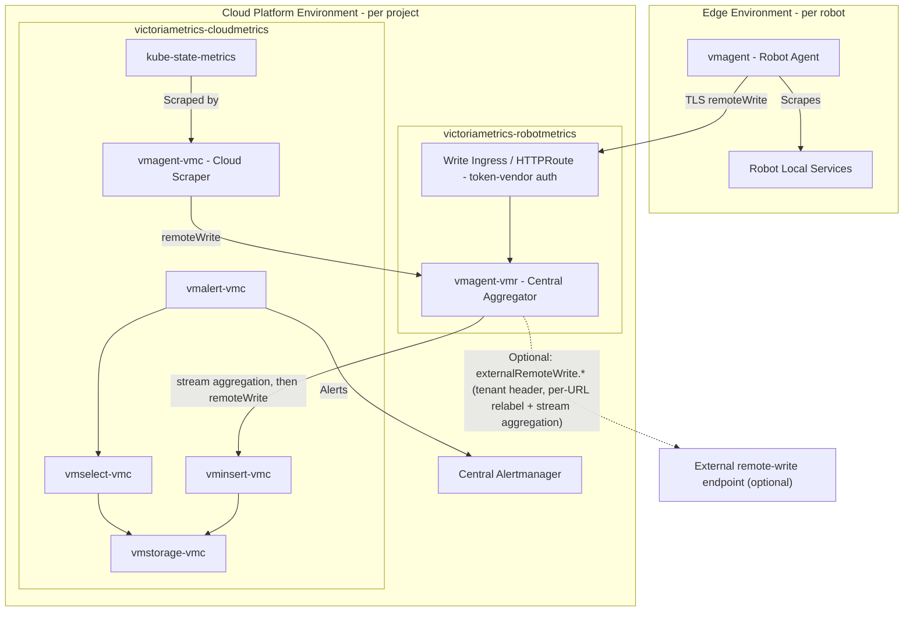

# VictoriaMetrics Telemetry Architecture

## Overview

VictoriaMetrics in this repository is split into two distinct observability domains to isolate high-cardinality, potentially unstable network edge telemetry from internal cloud infrastructure telemetry.

Each project runs a **single vmcluster** (`vmc`). Each robot runs exactly **one** `vmagent`. All samples, from robots and from the cloud, pass through one **central aggregation vmagent** (`vmagent-vmr`, always one replica). It applies stream aggregation centrally and writes to the vmcluster and, optionally, to other remote-write compatible endpoints.

Both components live under this directory:

1. **`victoriametrics-robotmetrics`**:
   * **Domain**: Robot telemetry (data originating from physical edge robots) and central aggregation.
   * **Deployment Targets**: Deploys one small `vmagent` on each robot, and the central aggregation `vmagent` (`vmagent-vmr`) in the cloud. No storage.
2. **`victoriametrics-cloudmetrics`**:
   * **Domain**: Cloud telemetry (cloud microservices and Kubernetes infrastructure). It also provides **storage, query, and alerting for all metrics**.
   * **Deployment Target**: Cloud-only. Its `vmagent-vmc` scrapes `kube-state-metrics`, node exporters, and cloud services, and writes to the central aggregator. It owns the single `vmcluster` (`vminsert`/`vmstorage`/`vmselect`) and `vmalert`.

---

## Unified Architecture Diagram

## Extra Objects & Autoscaling

The `victoriametrics-cloudmetrics` and `victoriametrics-robotmetrics` charts support injecting arbitrary Kubernetes manifests (such as HPAs, VPAs, PodDisruptionBudgets, and custom scrapes) natively via the `extraObjects` value in `AppRollout`.

## Documentation

* [Robot Metrics README](victoriametrics-robotmetrics/README.md)
* [Cloud Metrics README](victoriametrics-cloudmetrics/README.md)
