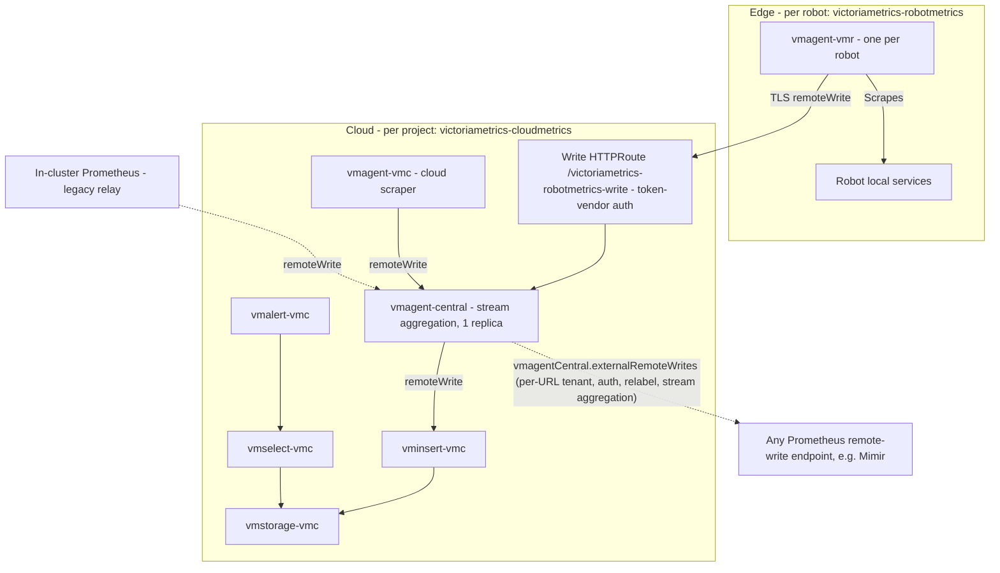

# VictoriaMetrics Telemetry Architecture

## Overview

VictoriaMetrics in this repository is split into two distinct observability domains to isolate high-cardinality, potentially unstable network edge telemetry from internal cloud infrastructure telemetry.

Each project runs a **single vmcluster** (`vmc`). Each robot runs exactly **one** vmagent (`vmagent-vmr`). Every writer (robot vmagents, the cloud scraper `vmagent-vmc` and in-cluster Prometheus) sends to one **central aggregation vmagent** (`vmagent-central`, always one replica) that runs next to the vmcluster. It applies stream aggregation and writes to `vminsert-vmc` and to any number of Prometheus remote-write compatible endpoints (for example a Grafana Mimir instance).

Both charts live under this directory:

1. **`victoriametrics-robotmetrics`**: robot-only app. Deploys `vmagent-vmr` on each robot. It scrapes local targets, buffers on disk and remote-writes to the cloud write route.
2. **`victoriametrics-cloudmetrics`**: cloud-only app, the metrics backend of the project:
   * `vmagent-vmc`: scrapes `kube-state-metrics`, node exporters and cloud services.
   * `vmagent-central`: the robot write route ends here, along with `vmagent-vmc` and Prometheus remote writes. Applies stream aggregation and fans out to the vmcluster and `vmagentCentral.externalRemoteWrites`.
   * The single `vmcluster` (`vminsert`/`vmstorage`/`vmselect`) and `vmalert`.

---

## Unified Architecture Diagram

## Extra Objects & Autoscaling

The `victoriametrics-cloudmetrics` and `victoriametrics-robotmetrics` charts support injecting arbitrary Kubernetes manifests (such as HPAs, VPAs, PodDisruptionBudgets, and custom scrapes) natively via the `extraObjects` value in `AppRollout`.

## Documentation

* [Robot Metrics README](victoriametrics-robotmetrics/README.md)
* [Cloud Metrics README](victoriametrics-cloudmetrics/README.md)
