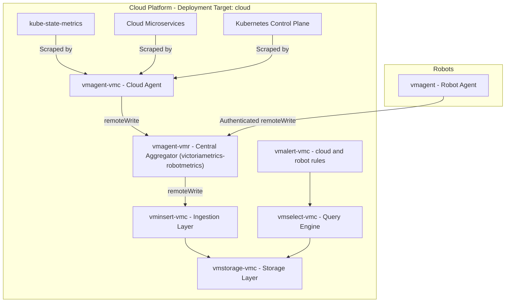
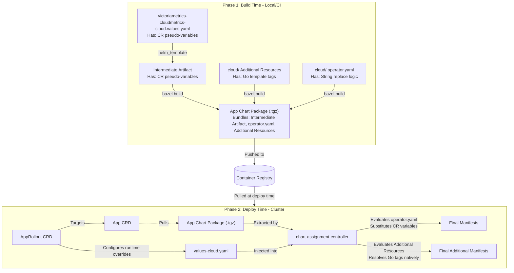

# VictoriaMetrics - Cloud Metrics (`victoriametrics-cloudmetrics`)

## Overview

`victoriametrics-cloudmetrics` deploys the **single per-project VictoriaMetrics cluster** (`vmc`) that stores both:

* **Cloud Service and Infrastructure Telemetry** (metrics originating within the cloud platform and Kubernetes control plane), scraped by the cloud vmagent `vmagent-vmc`.
* **Robot Telemetry**, remote-written by the robot vmagents of the `victoriametrics-robotmetrics` app.

All writes go through the **central aggregator vmagent** (`vmagent-vmr`, deployed by `victoriametrics-robotmetrics` in namespace `app-victoriametrics-robotmetrics`), which applies stream aggregation and forwards everything to `vminsert-vmc`. `vmalert-vmc` evaluates all alerting/recording rules (cloud and robot) against `vmselect-vmc`.

This chart is **cloud-only** and has no edge or robot component; the robot-side vmagent and the central aggregator live in `victoriametrics-robotmetrics`.

---

## Architecture Diagram

### Remote write target

`vmagent-vmc` writes to the URL in `victoriametrics_cloudmetrics_remote_write_url` (see `values-cloud.yaml`), which defaults to the central aggregator:
`http://vmagent-vmr.app-victoriametrics-robotmetrics.svc.cluster.local:8429/victoriametrics/robots/vmagent/api/v1/write`.
Setting it to `""` makes `vmagent-vmc` write directly to `vminsert-vmc` (useful if `victoriametrics-robotmetrics` is not deployed). Entries in `vmagent.additionalRemoteWrites` are added on top of this primary target.

### Rule selection

`vmalert-vmc` is rendered with `selectAllByDefault: true`, `ruleSelector: {}` and `ruleNamespaceSelector: {}` (unless overridden in `values-cloud.yaml`). With the VictoriaMetrics operator watching all namespaces, an empty (non-nil) namespace selector matches every namespace, so `VMRule`s (and `PrometheusRule`s, which the operator converts to `VMRule`s) from all namespaces, including `app-victoriametrics-robotmetrics`, are evaluated.

### Sizing

Because `vmc` now also stores robot metrics, the storage, retention and resource defaults in `values-cloud.yaml` (originally sized for cloud-only data) should be revisited.

---

## Key Terminology

* **Telemetry Domain**: `cloudmetrics` (metrics originating from cloud services and Kubernetes infrastructure). The `vmc` cluster additionally stores the `robotmetrics` domain.
* **Deployment Target**: `cloud` (Cloud-only deployment; no robot edge agent).

---

## Configuration Data Flow

The configuration of this chart passes through a two-phase template expansion. Phase 1 (Build Time) bypasses Helm's static schema validation by injecting placeholder variables. Phase 2 (Deploy Time) resolves those placeholders using AppRollout configurations, while simultaneously evaluating natively authored supplementary templates.

*See the [App Chart Variable Substitution Guide](../../app_charts_variable_substitution.md) for more details on the exact substitution steps and intermediate artifact extraction.*

### File Reference

#### Build-Time Files (Phase 1)
* `BUILD.bazel`: Renders the upstream helm chart and packages everything into an `app_chart` tarball.
* `victoriametrics-cloudmetrics-cloud.values.yaml`: Build-time helm values. It configures the core components but contains pseudo-variables (e.g., `$CR_VICTORIAMETRICS_CLOUDMETRICS_VMSTORAGE_RESOURCES_OBJECT: REMOVE_ME`) to bypass strict Helm array/object schema validation.
* **Intermediate Artifact**: An internal YAML file generated by `helm_template` and bundled into the `app_chart`. It still contains the `$CR_...` pseudo-variables.

#### Deploy-Time Files (Phase 2)
* **App CRD**: The resource pointing to the `app_chart` tarball in the registry.
* **AppRollout CRD**: The orchestrating resource that provisions runtime overrides (replicas, scaling limits, retention times) via the `values-cloud.yaml` structure.
* `values-cloud.yaml`: The runtime configuration payload injected by the AppRollout.
* `cloud/victoriametrics-cloudmetrics-operator.yaml`: The deployment script (Go `text/template`). Executed by the `chart-assignment-controller`, it reads the Intermediate Artifact and substitutes the `$CR_...` pseudo-variables with the structured data from `values-cloud.yaml`. This is where pseudo-variables cease to exist.

#### Additional Resources
These natively authored YAMLs reside in the `cloud/` directory and are bundled into the App Chart package. They do NOT contain pseudo-variables. Instead, they use standard Go text/template tags (e.g., `{{ .Values.domain }}`). The `chart-assignment-controller` evaluates them natively alongside `operator.yaml` using the data injected from `values-cloud.yaml`.
* `cloud/victoriametrics-cloudmetrics-ingress.yaml`: Ingress definition exposing the `vmselect` UI/API behind OAuth2 proxy authentication.
* `cloud/victoriametrics-cloudmetrics-read-http-route.yaml`: Gateway API `HTTPRoute` for modern secured access to `vmselect`.
* `cloud/base-alerts.yaml`: Prometheus alerting rules specific to cloud infrastructure.
### Accessing the Cloudmetrics UI

You can securely access the internal cluster metrics and dashboards through the authenticated Ingress / Gateway endpoints:

* **VMUI (Query Dashboard):** `https://<domain>/victoriametrics/cloud/select/0/vmui/`
* **Active Alerts Dashboard:** `https://<domain>/victoriametrics/cloud/vmalert/` (Web UI tabs at `/victoriametrics/cloud/vmalert/vmalert/groups` and `/victoriametrics/cloud/vmalert/vmalert/alerts`)
* **VMAgent Dashboard & Scrape Targets:** `https://<domain>/victoriametrics/cloud/vmagent/` and `https://<domain>/victoriametrics/cloud/vmagent/targets`
