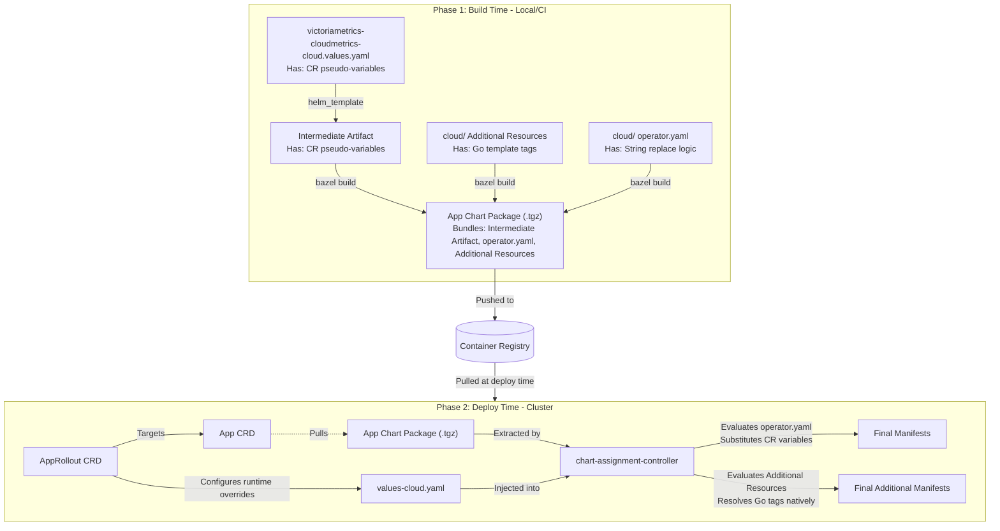

# VictoriaMetrics - Cloud Metrics (`victoriametrics-cloudmetrics`)

## Overview

`victoriametrics-cloudmetrics` is the metrics backend of a project. It deploys:

* **`vmagent-vmc`**: scrapes cloud services, `kube-state-metrics`, node exporters and the Kubernetes control plane.
* **`vmagent-central`**: the central aggregation vmagent (always one replica, ingest only). It receives:
  * the robot vmagents (`vmagent-vmr`, from `victoriametrics-robotmetrics`) through the token-vendor protected write route `/victoriametrics-robotmetrics-write` (HTTPRoute `victoriametrics-cloudmetrics-write` + SecurityPolicy `victoriametrics-cloudmetrics-write-auth`);
  * `vmagent-vmc`;
  * in-cluster Prometheus remote write, at `http://vmagent-central.<namespace>.svc.cluster.local:8429/victoriametrics/cloud/vmagent-central/api/v1/write`.

  It applies stream aggregation and writes to `vminsert-vmc` and to every entry in `vmagentCentral.externalRemoteWrites`.
* **The single vmcluster** (`vminsert-vmc`, `vmstorage-vmc`, `vmselect-vmc`) and **`vmalert-vmc`**, which evaluates all cloud and robot rules.

See the [architecture diagram](../README.md#architecture-diagram) for the data flow.

---

### Central aggregation vmagent (`vmagentCentral` in `values-cloud.yaml`)

* `enabled` (default `true`). When `false`, `vmagent-central` is not deployed: `vmagent-vmc` and the robot write route send to `vminsert-vmc` directly.
* `streamAggrConfig`: global stream aggregation, applied before writing to **every** destination, including `vminsert-vmc`.

> [!WARNING]
> By default vmagent drops the input samples that match an aggregation rule and only writes the aggregates. For the global `streamAggrConfig` this chart sets `keepInput: true` unless you set `keepInput` yourself, so the vmcluster keeps the raw series. Setting `keepInput: false` removes the matched raw series from **every** destination, `vmc` included. To send only aggregates to one endpoint, use `externalRemoteWrites[].streamAggrConfig` instead.

* `externalRemoteWrites`: any number of Prometheus remote-write compatible endpoints, written after `vminsert-vmc`. Each entry takes:
  * `url`;
  * `tenant`, sent as `X-Scope-OrgID`;
  * `headers`;
  * `bearerTokenFile`, rendered into the per-URL `-remoteWrite.bearerTokenFile` list so the token only goes to that endpoint;
  * `inlineUrlRelabelConfig` and `streamAggrConfig`, which apply to that endpoint only (matched input samples are dropped for that endpoint unless `keepInput: true`);
  * `bearerTokenSecret`, `basicAuth`, `oauth2`, `tlsConfig` and `sendTimeout`, passed through.
* `containers`, `volumes`, `volumeMounts`: e.g. a sidecar that keeps a token file fresh.
* `serviceAccount.annotations`: applied to the `vmagent-central` ServiceAccount, which the chart creates and the VMAgent uses (e.g. for Workload Identity).
* `image`: defaults to the `vmagent-vmc` image tag; set `image.tag` to pin another version.
* `externalLabels`: labels set on every series `vmagent-central` forwards, overriding the value sent by the writer. Rendered as `-remoteWrite.label` (`spec.remoteWriteSettings.label`), because `spec.externalLabels` only applies to scraped series and `vmagent-central` does not scrape.
* `extraArgs`, `resources`, `nodeSelector`, `tolerations`. `http.pathPrefix` is fixed to `/victoriametrics/cloud/vmagent-central`, because the routes depend on it.
* `statefulMode` (default `true`) and `statefulStorage`: vmagent keeps a separate on-disk queue per destination, so an outage of one endpoint does not block the others. In stateful mode the queues live on a PersistentVolume and survive pod restarts. Each queue is bounded by `extraArgs."remoteWrite.maxDiskUsagePerURL"` (default `5GB`); size `statefulStorage` for `maxDiskUsagePerURL x (1 + len(externalRemoteWrites))`.
* The UI is at `<domain>/victoriametrics/cloud/vmagent-central/`. The legacy `/victoriametrics/robots/...` URLs redirect to `/victoriametrics/cloud/...` (`/victoriametrics/robots/vmagent/...` goes to `/victoriametrics/cloud/vmagent-central/...` when `vmagent-central` is enabled).

### vmagent-vmc remote write target

`victoriametrics_cloudmetrics_remote_write_url` overrides where `vmagent-vmc` writes. Empty (default) means `vmagent-central` when it is enabled, otherwise `vminsert-vmc`.

### Rule selection

`vmalert-vmc` is rendered with `selectAllByDefault: true`, `ruleSelector: {}` and `ruleNamespaceSelector: {}` (unless overridden in `values-cloud.yaml`). With the VictoriaMetrics operator watching all namespaces, an empty (non-nil) namespace selector matches every namespace, so `VMRule`s (and `PrometheusRule`s, which the operator converts to `VMRule`s) from all namespaces are evaluated.

### Sizing

* `vmc` stores both robot and cloud metrics. Size `vmcluster.spec.vmstorage` storage for the combined ingestion rate times `retentionPeriod`, and `vminsert`/`vmselect` resources for the combined write and query load.
* `vmagent-central` carries every write of the project and cannot be scaled horizontally (stream aggregation needs all samples of a series on one instance). Its memory grows with the number of active series under aggregation and with the ingestion rate; scale `vmagentCentral.resources` vertically with the fleet and watch `vmagent_remotewrite_pending_data_bytes` and container memory usage.

### Upgrading from the previous layout

Earlier versions deployed a separate robot vmcluster (`vmr`) from `victoriametrics-robotmetrics`. When upgrading an existing project:

* Roll out `victoriametrics-robotmetrics` **before** `victoriametrics-cloudmetrics`. Both versions define routes for the same host and paths (`/victoriametrics-robotmetrics-write`, `/victoriametrics/robots`); ingress-nginx rejects or merges duplicate Ingresses and the Gateway prefers the older HTTPRoute. Robots buffer on disk in the meantime.
* Point in-cluster Prometheus `remoteWrite` at `vmagent-central` (URL above) instead of `vminsert-vmr`.
* Data stored in `vmr` is not migrated.
* Robot rules are evaluated by `vmalert-vmc`; while both apps are deployed, alerts may fire twice.

---

## Key Terminology

* **Telemetry Domains**: `cloudmetrics` (cloud services and Kubernetes infrastructure) and `robotmetrics` (written by the robot vmagents); both are stored in `vmc`.
* **Deployment Target**: `cloud` (Cloud-only deployment; no robot edge agent).

---

## Configuration Data Flow

The configuration of this chart passes through a two-phase template expansion. Phase 1 (Build Time) bypasses Helm's static schema validation by injecting placeholder variables. Phase 2 (Deploy Time) resolves those placeholders using AppRollout configurations, while simultaneously evaluating natively authored supplementary templates.

*See the [App Chart Variable Substitution Guide](../../app_charts_variable_substitution.md) for more details on the exact substitution steps and intermediate artifact extraction.*

### File Reference

#### Build-Time Files (Phase 1)
* `BUILD.bazel`: Renders the upstream helm chart and packages everything into an `app_chart` tarball.
* `victoriametrics-cloudmetrics-cloud.values.yaml`: Build-time helm values. It configures the core components but contains pseudo-variables (e.g., `$CR_VICTORIAMETRICS_CLOUDMETRICS_VMSTORAGE_RESOURCES_OBJECT: REMOVE_ME`) to bypass strict Helm array/object schema validation.
* **Intermediate Artifact**: An internal YAML file generated by `helm_template` and bundled into the `app_chart`. It still contains the `$CR_...` pseudo-variables.

#### Deploy-Time Files (Phase 2)
* **App CRD**: The resource pointing to the `app_chart` tarball in the registry.
* **AppRollout CRD**: The orchestrating resource that provisions runtime overrides (replicas, scaling limits, retention times) via the `values-cloud.yaml` structure.
* `values-cloud.yaml`: The runtime configuration payload injected by the AppRollout.
* `cloud/victoriametrics-cloudmetrics-operator.yaml`: The deployment script (Go `text/template`). Executed by the `chart-assignment-controller`, it reads the Intermediate Artifact and substitutes the `$CR_...` pseudo-variables with the structured data from `values-cloud.yaml`. This is where pseudo-variables cease to exist.

#### Additional Resources
These natively authored YAMLs reside in the `cloud/` directory and are bundled into the App Chart package. They do NOT contain pseudo-variables. Instead, they use standard Go text/template tags (e.g., `{{ .Values.domain }}`). The `chart-assignment-controller` evaluates them natively alongside `operator.yaml` using the data injected from `values-cloud.yaml`.
* `cloud/victoriametrics-cloudmetrics-ingress.yaml`: Ingress definition exposing the `vmselect` UI/API behind OAuth2 proxy authentication.
* `cloud/victoriametrics-cloudmetrics-read-http-route.yaml`: Gateway API `HTTPRoute` for modern secured access to `vmselect`.
* `cloud/victoriametrics-cloudmetrics-write-http-route.yaml`: the token-vendor protected robot write route `/victoriametrics-robotmetrics-write`, forwarding to `vmagent-central` (or `vminsert-vmc` when it is disabled).
* `cloud/base-alerts.yaml`: Prometheus alerting rules specific to cloud infrastructure.
### Accessing the Cloudmetrics UI

You can securely access the internal cluster metrics and dashboards through the authenticated Ingress / Gateway endpoints:

* **VMUI (Query Dashboard):** `https://<domain>/victoriametrics/cloud/select/0/vmui/`
* **Active Alerts Dashboard:** `https://<domain>/victoriametrics/cloud/vmalert/` (Web UI tabs at `/victoriametrics/cloud/vmalert/vmalert/groups` and `/victoriametrics/cloud/vmalert/vmalert/alerts`)
* **VMAgent Dashboard & Scrape Targets:** `https://<domain>/victoriametrics/cloud/vmagent/` and `https://<domain>/victoriametrics/cloud/vmagent/targets`
