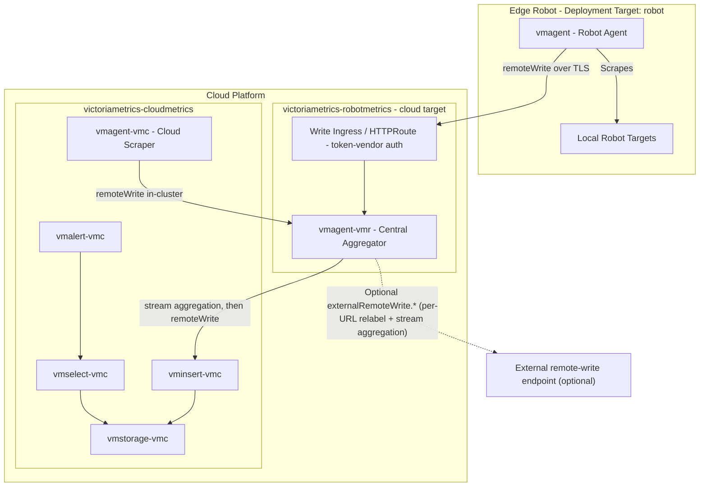
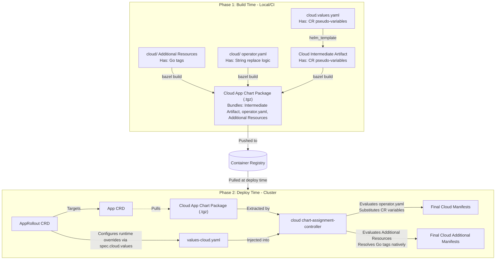

# VictoriaMetrics - Robot Metrics (`victoriametrics-robotmetrics`)

## Overview

`victoriametrics-robotmetrics` is the observability app chart dedicated to **Robot Telemetry** (metrics originating from edge robots) and to the **central aggregation vmagent** of each project.

Each project runs a **single vmcluster**, owned by the [`victoriametrics-cloudmetrics`](../victoriametrics-cloudmetrics/README.md) chart (`vmc`). This chart does not run any storage itself. It defines two deployment targets:

1. **Robot Target (`values-robot.yaml`)**: Deploys exactly **one** `vmagent` on each robot. It scrapes local targets, buffers on disk, and remote-writes over TLS to the central aggregator in the cloud. It does not run any vmcluster/vmalert and does no stream aggregation.
2. **Cloud Target (`values-cloud.yaml`)**: Deploys only the **central aggregation `vmagent`** (`vmagent-vmr`, always one replica). It receives remote writes from every robot vmagent and from the cloud scraper vmagent (`vmagent-vmc`). It can apply [stream aggregation](https://docs.victoriametrics.com/victoriametrics/stream-aggregation/) and forwards the result to `vminsert-vmc` and, when `externalRemoteWrite.enabled`, to an external remote-write compatible endpoint (plus any `additionalRemoteWrites`).

---

## Architecture Diagram

---

## Key Terminology

* **Telemetry Domain**: `robotmetrics` (What is measured: telemetry originating from edge robots).
* **Deployment Targets**:
  * `robot`: Deploys `vmagent` on the physical robot.
  * `cloud`: Deploys the central aggregation `vmagent` (`vmagent-vmr`) in the cloud. Storage, querying and alerting live in `vmc`.

---

## Central Aggregator Configuration (`values-cloud.yaml`)

* `victoriametrics_robotmetrics_central_remote_write_url`: The primary destination. Defaults to `vminsert-vmc` in `app-victoriametrics-cloudmetrics`. It is ignored if `vmagent.spec.remoteWrite` is set explicitly.
* `vmagent.spec.streamAggrConfig`: The global stream aggregation config (VMAgent `spec.streamAggrConfig`). It applies to the samples of every robot and of the cloud vmagent, before they are written to **every** destination. Empty means pass-through.
* `externalRemoteWrite.*`: An optional external destination (any Prometheus remote-write compatible endpoint), appended after the vmcluster:
  * `externalRemoteWrite.enabled`, `externalRemoteWrite.url` (remote-write URL), `externalRemoteWrite.tenant` (tenant ID for multi-tenant backends, sent as the `X-Scope-OrgID` header; defaults to the project) and extra `externalRemoteWrite.headers`.
  * Auth: `externalRemoteWrite.bearerTokenFile` (read on every request, e.g. a short-lived token written by a sidecar that you inject through `vmagent.spec.containers`, `.volumes` and `.volumeMounts`). The chart renders `-remoteWrite.bearerTokenFile` as a per-URL list, so the token is only sent to this endpoint. `bearerTokenSecret`, `basicAuth`, `oauth2` and `tlsConfig` are passed through instead if set.
  * `externalRemoteWrite.inlineUrlRelabelConfig`: relabeling for this destination only, e.g. to drop series that should stay in the project.
  * `externalRemoteWrite.streamAggrConfig`: stream aggregation for this destination only. The vmcluster keeps the full-resolution stream.
* `vmagent.additionalRemoteWrites`: Other generic destinations that receive the same (globally aggregated) stream.
* The central vmagent always runs **exactly one replica** (`vmagent.spec.replicaCount` other than 1 is rejected): stream aggregation is only correct if every sample of a series reaches the same instance.
* vmagent keeps a separate on-disk queue per destination, so an outage of an external endpoint does not block writes to the vmcluster. Bound the queue with `vmagent.spec.extraArgs."remoteWrite.maxDiskUsagePerURL"`.

> **Note:** The cloud scraper `vmagent-vmc` writes to `http://vmagent-vmr.app-victoriametrics-robotmetrics.svc.cluster.local:8429/victoriametrics/robots/vmagent/api/v1/write`. This is configured in the cloudmetrics chart (`victoriametrics_cloudmetrics_remote_write_url`).

---

## Robot Target (`values-robot.yaml`)

Each robot runs exactly **one** vmagent (`vmagent-vmr` in the robot cluster). It scrapes every ServiceMonitor/PodMonitor on the robot, applies optional baseline relabeling (`vmagent.spec.inlineRelabelConfig`, i.e. `-remoteWrite.relabelConfig`), buffers on disk (`vmagent.max_disk_usage`) and remote-writes to the central aggregator through the write route.

The chart refuses to render:

* `vmagent.spec.replicaCount > 1` (every replica would scrape every target) or `vmagent.spec.shardCount`;
* stream aggregation on the robot (`vmagent.spec.streamAggrConfig` or `streamAggr*` extraArgs). Aggregation runs on the central vmagent.

---

## Configuration Data Flow

This chart packages two independent Helm configurations (one for the cloud ingestion hub, one for the edge scraping agent) into a single `app` target. Phase 1 (Build Time) bypasses Helm's static schema validation by injecting placeholder variables into intermediate artifacts. Phase 2 (Deploy Time) resolves those placeholders using targeted AppRollout configurations, while simultaneously evaluating natively authored supplementary templates.

*See the [App Chart Variable Substitution Guide](../../app_charts_variable_substitution.md) for more details on the exact substitution steps and intermediate artifact extraction.*

### Target Deployment Flow

The diagram below illustrates the deployment pipeline for the **cloud target**. The **robot target** follows an identical, parallel process using its respective `robot.values.yaml` build parameters and `values-robot.yaml` runtime overrides.

### File Reference

#### Build-Time Files (Phase 1)
* `BUILD.bazel`: Renders the chart and packages both the cloud and robot targets into `app_chart` tarballs.
* `victoriametrics-robotmetrics-cloud.values.yaml`: Configures the cloud target. It disables all storage and alerting components (`vmcluster`, `vmalert`, default rules). It configures the central aggregation `vmagent` using pseudo-variables (e.g., `$CR_...: REMOVE_ME`) for array/object fields, so that they pass strict Helm typing checks.
* `victoriametrics-robotmetrics-robot.values.yaml`: Configures the edge agent stack. It disables cluster storage components and uses pseudo-variables to configure `vmagent` scraping.
* **Intermediate Artifacts**: Internal YAML files generated by `helm_template` and bundled into the respective `app_chart` packages. They contain the unresolved `$CR_...` pseudo-variables.

#### Deploy-Time Files (Phase 2)
* **App CRD**: The resource pointing to the `app_chart` tarballs in the registry.
* **AppRollout CRD**: The orchestrating resource that targets distinct node selectors and injects scoped configuration into the `values-cloud.yaml` or `values-robot.yaml` structures.
* `values-cloud.yaml`: Deployment parameters mapped from the AppRollout for the central aggregation vmagent.
* `values-robot.yaml`: Deployment parameters mapped from the AppRollout for specific edge robots.
* `cloud/victoriametrics-robotmetrics-operator.yaml`: Go template executed in the cloud. It loads the Cloud Intermediate Artifact and replaces the `$CR_...` pseudo-variables with structured data from `values-cloud.yaml`. This removes the pseudo-variables completely.
* `robot/victoriametrics-robotmetrics-operator.yaml`: Go template executed on edge robots. It loads the Robot Intermediate Artifact and replaces the `$CR_...` pseudo-variables with structured data from `values-robot.yaml`. This removes the pseudo-variables completely.

#### Additional Cloud Resources (Ingestion Hub)
These natively-authored YAMLs reside in the `cloud/` directory and are bundled into the Cloud App Chart package. They do NOT contain pseudo-variables. Instead, they use standard Go text/template tags (e.g., `{{ .Values.domain }}`). The `chart-assignment-controller` evaluates them natively alongside the rendered operator outputs.
* `cloud/victoriametrics-robotmetrics-ingress.yaml`, `cloud/victoriametrics-robotmetrics-read-http-route.yaml`: Expose the central aggregator UI (`/victoriametrics/robots/vmagent`) behind interactive OAuth2 authentication. They also redirect the legacy `/victoriametrics/robots/select` and `/victoriametrics/robots/vmalert` URLs to `/victoriametrics/cloud/...`.
* `cloud/victoriametrics-robotmetrics-write-ingress.yaml`, `cloud/victoriametrics-robotmetrics-write-http-route.yaml`: Machine-to-machine endpoints that expose the central aggregation `vmagent` to edge robots for `remoteWrite` data ingestion. They are secured via token-vendor robot tokens.

#### Additional Robot Resources (Edge)
These natively-authored YAMLs reside in the `robot/` directory and are bundled into the Robot App Chart package. They use standard Go text/template tags and are evaluated natively by the controller.
* `robot/smartctl-exporter.yaml`: Hardware exporter DaemonSet deployed to robots to read S.M.A.R.T. disk stats.
### Accessing the Robotmetrics UI

Robot metrics live in the single per-project vmcluster. Filter them by the `robot` label, e.g. `up{robot="my-robot"}`.

* **VMUI (Query Dashboard):** `https://<domain>/victoriametrics/cloud/select/0/prometheus/vmui/`. The old `/victoriametrics/robots/select/...` URLs redirect here.
* **Active Alerts Dashboard:** `https://<domain>/victoriametrics/cloud/vmalert/`. The old `/victoriametrics/robots/vmalert/...` URLs redirect here.
* **Central Aggregator Status, Targets & Stream Aggregation:** `https://<domain>/victoriametrics/robots/vmagent/`
