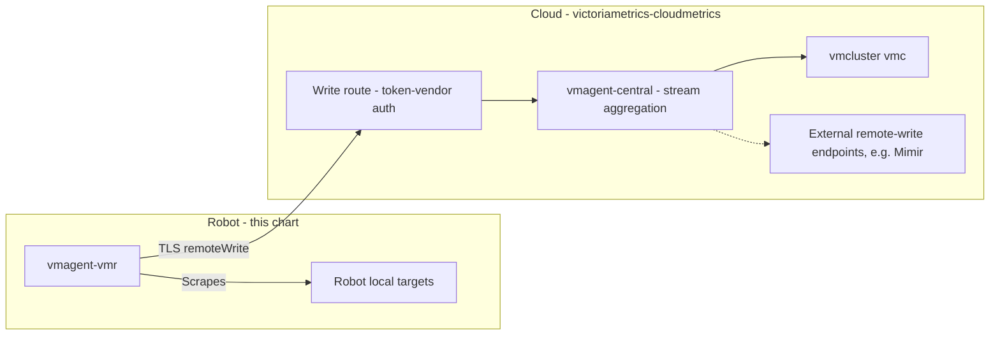

# VictoriaMetrics - Robot Metrics (`victoriametrics-robotmetrics`)

## Overview

`victoriametrics-robotmetrics` is a **robot-only** app. It deploys exactly **one** vmagent per robot (`vmagent-vmr`), plus `kube-state-metrics`, `prometheus-node-exporter` and `smartctl-exporter`.

`vmagent-vmr` scrapes every ServiceMonitor/PodMonitor on the robot, buffers on disk (`vmagent.max_disk_usage`), and remote-writes over TLS to the project's write route `/victoriametrics-robotmetrics-write`. That route, and everything behind it, belongs to [`victoriametrics-cloudmetrics`](../victoriametrics-cloudmetrics/README.md):



Robot metrics are queried in the cloudmetrics vmcluster, filtered by the `robot` label (e.g. `up{robot="my-robot"}`): `https://<domain>/victoriametrics/cloud/select/0/prometheus/vmui/`.

## Robot Values (`values-robot.yaml`, set under AppRollout `spec.robots[].values`)

* `vmagent.spec.remoteWrite` (or `victoriametrics_robotmetrics_remote_write_url`): the cloud write route, e.g. `https://www.endpoints.<project>.cloud.goog/victoriametrics-robotmetrics-write/api/v1/write`, plus the auth sidecars and volumes (`vmagent.spec.containers`, `initContainers`, `volumes`, `volumeMounts`).
* `vmagent.spec.inlineRelabelConfig`: baseline relabeling applied to everything the robot sends (`-remoteWrite.relabelConfig`).
* `vmagent.spec.externalLabels`: `robot` and `cluster` are set from `robot.name`.
* Scrape selectors, `extraArgs`, `resources`, `nodeSelector`, `tolerations`, and `prometheus-node-exporter.*`.

The chart refuses to render:

* `vmagent.spec.replicaCount > 1` (every replica would scrape every target) or `vmagent.spec.shardCount`;
* stream aggregation on the robot (`vmagent.spec.streamAggrConfig`, `streamAggr*` extraArgs, or `streamAggrConfig` on any `vmagent.spec.remoteWrite[]` / `vmagent.additionalRemoteWrites[]` entry). Aggregation runs on `vmagent-central` in the cloud.

## Build

```bash
bazel build src/app_charts/victoriametrics/victoriametrics-robotmetrics:victoriametrics-robotmetrics-chart.robot
```

The robot target uses the same two-phase rendering as the other VictoriaMetrics charts. See the [App Chart Variable Substitution Guide](../../app_charts_variable_substitution.md).
